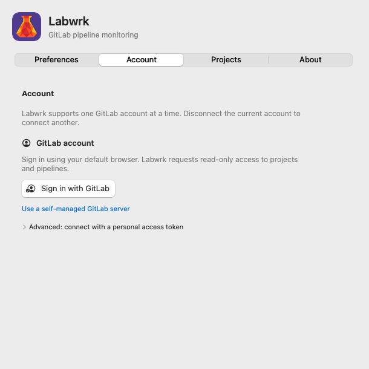
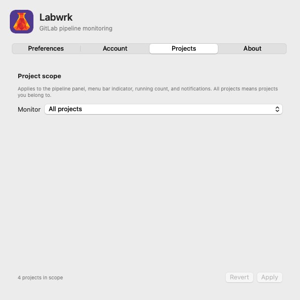
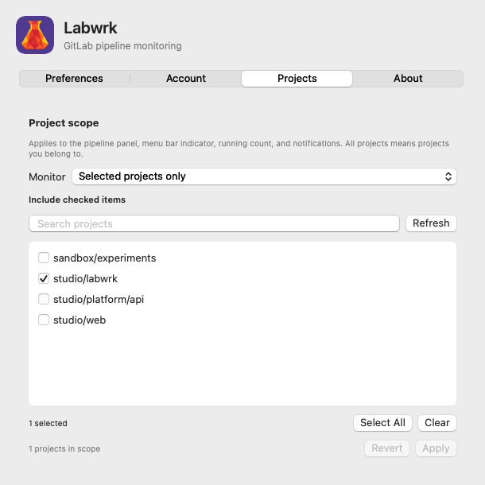
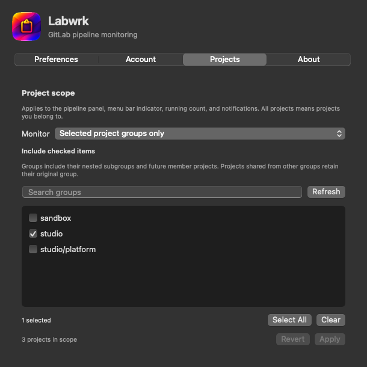
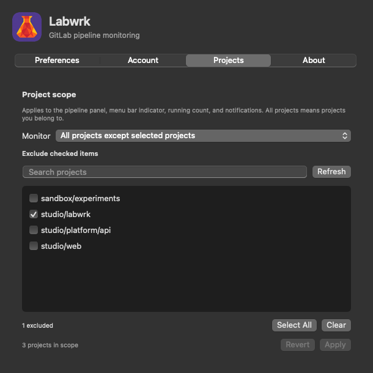
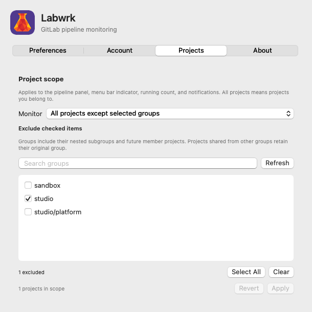
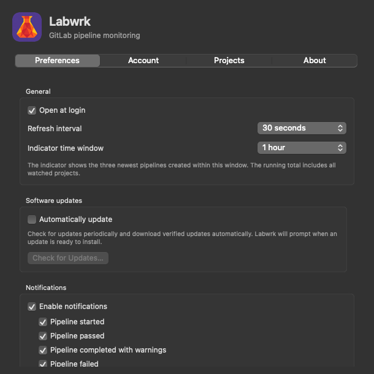
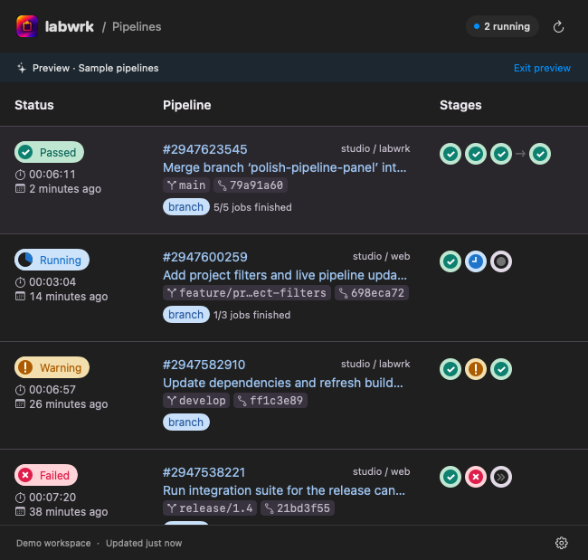

# Labwrk

A native macOS menu bar application for monitoring GitLab CI/CD pipelines. Follow builds across your projects, inspect job states, and receive notifications when pipelines start or finish.

The name combines GitLab with the idea of laboratory work: a small instrument for observing your pipeline activity.

**[Download the latest release](https://github.com/jeffcalaway/labwrk/releases/latest)** · **[Report an issue](https://github.com/jeffcalaway/labwrk/issues)**

Current release: **[Labwrk 1.1.13](https://github.com/jeffcalaway/labwrk/releases/tag/v1.1.13)**, for Apple silicon and macOS 14 or later.

> [!IMPORTANT]
> **First launch on macOS:** the current release is locally signed and has not been Apple-notarized. If macOS displays **“Labwrk Not Opened”**, use **System Settings → Privacy & Security → Open Anyway** as described below.

## Install and open Labwrk

1. Download the ZIP from [the official Releases page](https://github.com/jeffcalaway/labwrk/releases/latest).
2. Extract it and drag **Labwrk.app** into **Applications**.
3. Open **Labwrk** from Applications. If macOS blocks it, follow the first-launch steps below.

### First launch: “Labwrk Not Opened”

Only continue if you downloaded Labwrk directly from this repository and trust the release.

1. In the warning dialog, select **Done**.
2. Open **System Settings → Privacy & Security** and scroll to the **Security** section.
3. Find the message about Labwrk being blocked and select **Open Anyway**.
4. Authenticate if requested, then confirm **Open** when macOS asks again.

**Open Anyway appears after you have tried to open the app and macOS has blocked it.** If the message is absent, try opening Labwrk from Applications again, then return to Privacy & Security. See [Apple’s instructions for opening an unnotarized app](https://support.apple.com/en-us/102445).

This creates an exception for Labwrk; you do not need to disable macOS security protections globally. Future Apple-notarized releases will be identified in their release notes.

## Set up Labwrk

### 1. Connect your GitLab account

Labwrk lives in the **menu bar**, with no Dock icon. Click its indicator and open **Settings → Account** (or right-click the indicator and choose **Settings…**).

1. For GitLab.com, select **Sign in with GitLab**.
2. Finish authorization in your default browser, then return to Labwrk.
3. Confirm your account appears in the Account tab. Labwrk supports one account at a time; use **Disconnect** before switching accounts.

For a self-managed instance, select **Use a self-managed GitLab server** and enter its HTTPS address. If Labwrk asks you to enable browser sign-in, register an application on that GitLab server using the values shown in the setup dialog: name **Labwrk**, redirect URI `com.labwrk.mac://oauth/callback`, **Confidential unchecked**, and scope **read_api**. Paste the **Application ID** into Labwrk; it does not use the client secret.

Alternatively, expand **Advanced: connect with a personal access token**, create a token with **read_api** access, paste it into Labwrk, and choose **Connect with token**. Credentials are stored in macOS Keychain. Never include a token in a screenshot or support request.

### 2. Choose which projects to monitor

Open **Settings → Projects**. Your scope applies to **the pipeline panel, menu bar indicator, running count, and notifications**. “All projects” means projects you belong to on the connected GitLab server, not every public project on that server.

| What you want | Choose this mode | What to check |
| --- | --- | --- |
| Follow all your member projects | **All projects** | Nothing; new member projects are included automatically. |
| Focus on a few repositories | **Selected projects only** | Each project you want to monitor. |
| Follow an entire team or department | **Selected project groups only** | The groups you want to monitor, including their nested subgroups. |
| Follow almost everything, except noisy repositories | **All projects except selected projects** | The projects you want to exclude. |
| Ignore a sandbox or another team's groups | **All projects except selected groups** | The groups you want to exclude, including their nested subgroups. |

**To save a scope:** choose a mode, search or check the relevant projects/groups, review the **projects in scope** count, then click **Apply**. Changes are not saved until you apply them. **Revert** restores the saved selection. Apply is disabled when there are no pending changes.

**Select All** checks every item matching the current search. Clear the search first to select the full list. **Clear** removes all checks for the current project/group list. **Refresh** reloads the available projects and groups.

The screenshots below use fictional demo projects. They show saved configurations, so Apply is disabled.

#### Monitor everything

Choose **All projects**, then **Apply**. This is useful if you want all your work represented without maintaining a selection.

#### Focus on specific repositories

Choose **Selected projects only** and check, for example, `studio/labwrk`. Only checked projects are monitored. An empty selection in this mode deliberately monitors nothing.

#### Follow a whole group, including subgroups

Choose **Selected project groups only** and check `studio`. This includes `studio/labwrk`, `studio/web`, and `studio/platform/api`. You do not need to check `studio/platform` separately. To monitor only the subgroup, check `studio/platform` instead of its parent.

Newly discovered member projects under a selected group are included automatically. Group choices follow the owning namespace: a project shared into a group from somewhere else keeps its original group for scope matching.

#### Exclude individual projects

Choose **All projects except selected projects** and check any repositories you want left out. Checked means **excluded** in this mode. Unchecked and newly discovered member projects remain in scope.

#### Exclude entire groups

Choose **All projects except selected groups** and check a group you do not want to follow. In this example, excluding `studio` also excludes `studio/platform`, leaving `sandbox/experiments` in scope. To ignore the sandbox instead, check `sandbox` and uncheck `studio`.

**Selection details:** empty include selections monitor nothing; empty exclude selections monitor all member projects. Saved scope persists between launches, and earlier saved project selections are preserved on upgrade. Disconnecting or connecting another account resets the scope. If an item becomes inaccessible, it appears as **Unavailable selection** so you can remove it. The inventory refreshes periodically (about every five minutes); use Refresh when you need newly created projects sooner. The count reflects the currently loaded inventory.

### 3. Set timing, notifications, and startup preferences

In **Settings → Preferences**, choose your refresh interval, indicator time window, whether to open at login, and notification types. Enable notifications and allow them in macOS when prompted. If notifications are blocked, use the **Open Notification Settings…** button when shown.

The default refresh interval is **30 seconds**. The indicator shows the **three newest pipelines created within its time window** (one hour by default); the running count covers all running top-level pipelines in your project scope, even outside that window. An empty indicator slot therefore does not necessarily mean nothing is running.

### 4. Check your pipelines and keep Labwrk updated

Click the menu bar indicator to open the pipeline panel. Confirm that the projects and running count match your chosen scope. If a scope looks empty, check the connected account, switch to the appropriate include/exclude mode, review the checked items, and click **Apply**. Use **Refresh** in Projects if your inventory is out of date.

Right-click a pipeline row to choose **Rerun Pipeline** (retry failed or canceled jobs) or **Rerun Last Job** (retry the most recently started job, including a successful job). Unavailable actions are disabled. If you previously connected with `read_api`, enable `api` scope for your GitLab OAuth application and reconnect, or connect with an `api` personal access token.

Choose **Check for Updates…** from the indicator’s right-click menu or **Settings → About**. You can also enable **Automatically update** in Preferences. Versions without a built-in updater need one manual installation of a newer version.

## Features

- Three compact status dots and a running-pipeline count in the menu bar; dots show the three newest pipelines within a configurable time window (60 minutes by default), with empty outlines for unused slots. Running pipelines use blue outlines. The count is hidden when no pipelines are running.
- A GitLab-style panel with pipeline status, repository links, stages, individual jobs, and downstream pipelines shown after an arrow.
- Refined hover and cursor feedback for panel links, status circles, and controls.
- GitLab.com browser sign-in; self-managed GitLab and personal access tokens are also supported.
- Five persistent project scope modes, with searchable project/group selection, nested-group support, and inclusion or exclusion rules.
- Separate notification controls for started, passed, warning, failed, canceled, and skipped pipelines.
- Four settings tabs: Preferences, Account, Projects, and About.
- Open at login, manual update checks, and optional automatic updates with signed update verification.

## Progress and privacy

While no jobs have finished, a running pipeline’s Status badge shows the blue clock. After the first job finishes, it shows a measured progress wedge. Pipeline status progress measures finished jobs, not elapsed time; running stages and jobs use a general clock icon. GitLab does not expose a percentage inside an individual job, so running jobs show a general clock icon and elapsed time when available. Downstream jobs contribute to job-completion progress; the parent’s overall status remains the status reported by GitLab. If downstream details are unavailable, progress is marked unavailable. The running count covers top-level pipelines in the watched projects. Status changes are observed by polling, every 30 seconds by default.

GitLab credentials are stored in macOS Keychain. The app reads GitLab project/pipeline data and retries jobs only when you choose a rerun action. Reruns require `api` scope and project permission to run jobs; existing `read_api` connections can continue monitoring. Software update checks contact the public update feed and GitHub release downloads, and do not send GitLab credentials.

## Support and license

Use [GitHub Issues](https://github.com/jeffcalaway/labwrk/issues) for bug reports and feature requests. Include your app and macOS versions and reproduction steps. Do not share access tokens, passwords, OAuth codes, or confidential project information.

Labwrk is **proprietary freeware**, free for personal and professional use. It is not open source. Redistribution, resale, rebranding, or derivative applications require separate authorization. See [LICENSE.md](LICENSE.md) and [third-party notices](THIRD_PARTY_NOTICES.txt).

This public repository contains documentation, branding, user support resources, and update information. The proprietary implementation is maintained separately.

Copyright © 2026 Jeff Calaway. All rights reserved. Labwrk is not affiliated with or endorsed by GitLab.

### Diagnostic logs

Open **Settings → Preferences → Diagnostics → Show Logs in Finder** to inspect automatically recorded API failures. Logs identify the endpoint, HTTP status, and project name/ID when available. Tokens, headers, and response bodies are excluded. Two rotating log files are retained in `~/Library/Logs/Labwrk`; review project names and server hostnames before sharing.

If a project returns HTTP 403 during pipeline listing, Labwrk skips it for that refresh and names it in a panel warning. Other projects continue refreshing. The running count is marked partial and excludes skipped projects; Labwrk retries access on the next refresh. Denied requests remain in the diagnostic logs.
