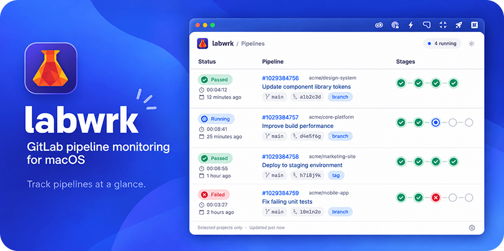
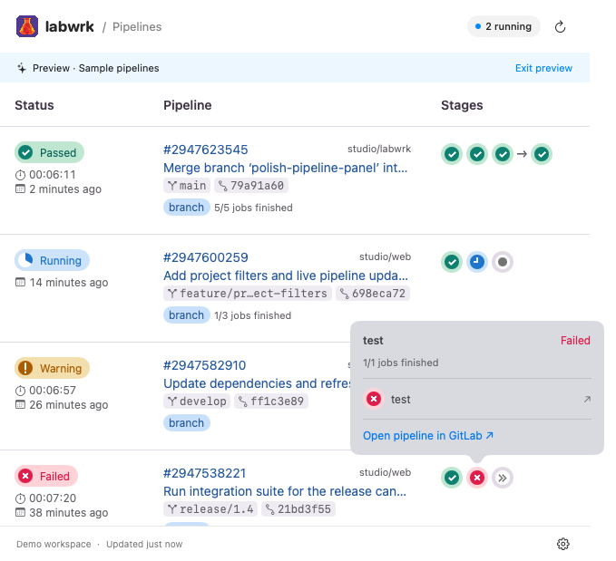
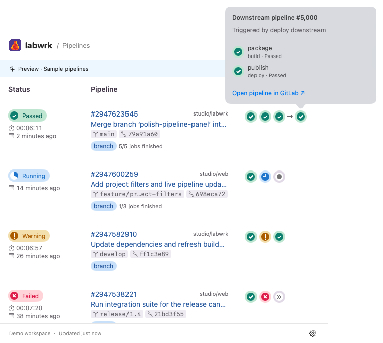
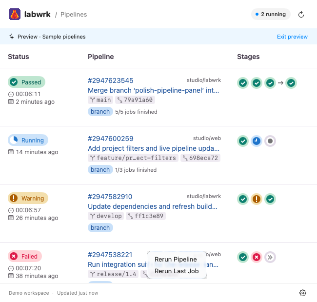

 

# Labwrk

A native macOS menu bar app for monitoring GitLab CI/CD pipelines. Follow builds across your projects, inspect jobs, rerun failures, and get notified when pipelines start or finish.

The name combines GitLab with the idea of laboratory work: a small instrument for observing your pipeline activity.

**[Download the latest release](https://github.com/jeffcalaway/labwrk/releases/latest)** · **[Report an issue](https://github.com/jeffcalaway/labwrk/issues)**

Current release: **[Labwrk 1.1.14](https://github.com/jeffcalaway/labwrk/releases/tag/v1.1.14)**, for Apple silicon and macOS 14 or later.

> [!IMPORTANT]
> **First launch on macOS:** the current release is locally signed and has not been Apple-notarized. If macOS displays **“Labwrk Not Opened”**, follow [the first-launch steps](#first-launch-labwrk-not-opened).

## Contents

- [Install](#install)
- [Set up Labwrk](#set-up-labwrk)
- [Use the pipeline panel](#use-the-pipeline-panel)
- [Keep Labwrk updated](#keep-labwrk-updated)
- [Features](#features)
- [How progress works](#how-progress-works)
- [Privacy](#privacy)
- [Troubleshooting](#troubleshooting)
- [Support and license](#support-and-license)

## Install

1. Download the ZIP from [the official Releases page](https://github.com/jeffcalaway/labwrk/releases/latest).
2. Extract it and drag **Labwrk.app** into **Applications**.
3. Open **Labwrk** from Applications.

Labwrk lives in the **menu bar** and has no Dock icon.

### First launch: “Labwrk Not Opened”

Only continue if you downloaded Labwrk directly from this repository and trust the release.

1. In the warning dialog, select **Done**.
2. Open **System Settings → Privacy & Security** and scroll to the **Security** section.
3. Find the message about Labwrk being blocked and select **Open Anyway**.
4. Authenticate if requested, then confirm **Open** when macOS asks again.

**Open Anyway** only appears after macOS has blocked the app once. If it’s missing, open Labwrk from Applications again, then return to Privacy & Security. See [Apple’s instructions for opening an unnotarized app](https://support.apple.com/en-us/102445).

This creates an exception for Labwrk only; you don’t need to disable macOS security protections. Future Apple-notarized releases will say so in their release notes.

## Set up Labwrk

### 1. Connect your GitLab account

Click the menu bar indicator and open **Settings → Account**, or right-click the indicator and choose **Settings…**.

1. For GitLab.com, select **Sign in with GitLab**.
2. Finish authorization in your default browser, then return to Labwrk.
3. Confirm your account appears in the Account tab.

Labwrk supports one account at a time. Use **Disconnect** before switching accounts.

**Self-managed GitLab:** select **Use a self-managed GitLab server** and enter its HTTPS address. If Labwrk asks you to enable browser sign-in, register an application on that server with these values:

| Setting | Value |
| --- | --- |
| Name | **Labwrk** |
| Redirect URI | `com.labwrk.mac://oauth/callback` |
| Confidential | **Unchecked** |
| Scopes | **api** |

Paste the **Application ID** into Labwrk. Labwrk doesn’t use the client secret.

**Personal access token:** expand **Advanced: connect with a personal access token**, create a token with **api** scope (or **read_api** for monitoring only), paste it into Labwrk, and choose **Connect with token**.

Credentials are stored in macOS Keychain. Never include a token in a screenshot or support request.

### 2. Choose which projects to monitor

Open **Settings → Projects**. Your scope applies to **the pipeline panel, menu bar indicator, running count, and notifications**. “All projects” means projects you belong to on the connected server, not every public project on it.

| What you want | Choose this mode | What to check |
| --- | --- | --- |
| Follow all your member projects | **All projects** | Nothing; new member projects are included automatically. |
| Focus on a few repositories | **Selected projects only** | Each project you want to monitor. |
| Follow an entire team or department | **Selected project groups only** | The groups to monitor, including their nested subgroups. |
| Follow almost everything, except noisy repositories | **All projects except selected projects** | The projects to exclude. |
| Ignore a sandbox or another team’s groups | **All projects except selected groups** | The groups to exclude, including their nested subgroups. |

**To save a scope:**

1. Choose a mode.
2. Search for and check the relevant projects or groups.
3. Review the **projects in scope** count.
4. Click **Apply**. Changes aren’t saved until you apply them.

**Revert** restores the saved selection. **Select All** checks every item matching the current search, so clear the search first to select everything. **Clear** removes all checks, and **Refresh** reloads the available projects and groups.

Expand an example below to see each mode. They use fictional demo projects and show saved configurations, so Apply is disabled.

<strong>Monitor everything</strong>

 

Choose **All projects**, then **Apply**. Useful when you want all your work represented without maintaining a selection.

<strong>Focus on specific repositories</strong>

 

Choose **Selected projects only** and check, for example, `studio/labwrk`. Only checked projects are monitored. An empty selection in this mode deliberately monitors nothing.

<strong>Follow a whole group, including subgroups</strong>

 

Choose **Selected project groups only** and check `studio`. This includes `studio/labwrk`, `studio/web`, and `studio/platform/api`; you don’t need to check `studio/platform` separately. To monitor only the subgroup, check `studio/platform` instead of its parent.

Newly discovered member projects under a selected group are included automatically. Group choices follow the owning namespace: a project shared into a group from elsewhere keeps its original group for scope matching.

<strong>Exclude individual projects</strong>

 

Choose **All projects except selected projects** and check the repositories to leave out. In this mode, checked means **excluded**. Unchecked and newly discovered member projects stay in scope.

<strong>Exclude entire groups</strong>

 

Choose **All projects except selected groups** and check a group you don’t want to follow. Here, excluding `studio` also excludes `studio/platform`, leaving `sandbox/experiments` in scope. To ignore the sandbox instead, check `sandbox` and uncheck `studio`.

**Good to know:**

- Empty include selections monitor nothing; empty exclude selections monitor all member projects.
- Your scope persists between launches, and earlier saved selections are preserved on upgrade. Disconnecting or connecting another account resets it.
- An item you can no longer access appears as **Unavailable selection** so you can remove it.
- The project inventory refreshes about every five minutes. Use **Refresh** to see newly created projects sooner.

### 3. Set timing, notifications, and startup

In **Settings → Preferences**, choose your refresh interval, indicator time window, whether to open at login, and which notifications to receive. Allow notifications when macOS asks. If they’re blocked, use **Open Notification Settings…** when it appears.

- **Refresh interval:** 30 seconds by default.
- **Indicator window:** the menu bar dots show the **three newest pipelines created within this window** (one hour by default).
- **Running count:** covers all running top-level pipelines in your scope, even outside the indicator window. An empty dot doesn’t necessarily mean nothing is running.

## Use the pipeline panel

Click the menu bar indicator to open the pipeline panel. Each row shows a pipeline’s status, duration, commit, branch, and stages. The pipeline number, project, commit title, branch, and commit SHA all open in GitLab when clicked.

Hover over the menu bar indicator for a summary of running pipelines and the pipelines its dots represent.

### See a stage’s jobs

Click any stage circle to list the jobs in that stage. **Click a job to open it, and its log, in GitLab.** Use **Open pipeline in GitLab** at the bottom to view the whole pipeline.

### Inspect downstream pipelines

Downstream (child or multi-project) pipelines appear after an arrow. Click one to see its jobs, then click a job to open it in GitLab.

### Rerun a pipeline or its last job

Right-click a pipeline row to rerun it:

- **Rerun Pipeline** retries the pipeline’s failed or canceled jobs.
- **Rerun Last Job** retries the most recently started job, even if it succeeded.

Unavailable actions are disabled. Successful reruns refresh the panel.

> [!NOTE]
> Reruns need **api** scope and permission to run jobs in that project. If you connected with `read_api`, enable `api` scope for your GitLab OAuth application and reconnect, or connect with an `api` personal access token. Monitoring keeps working with `read_api`.

If a scope looks empty, check the connected account and your mode in **Settings → Projects**, then click **Apply**.

## Keep Labwrk updated

Choose **Check for Updates…** from the indicator’s right-click menu or **Settings → About**. To update automatically, enable **Automatically update** in Preferences.

Versions without a built-in updater need one manual installation of a newer version.

## Features

- **Menu bar indicator:** three compact status dots for the newest pipelines in a configurable window, plus a running-pipeline count. Running pipelines use blue outlines, unused slots are empty outlines, and the count hides when nothing is running.
- **Pipeline panel:** GitLab-style rows with status, links, stages, individual jobs, and downstream pipelines.
- **Reruns:** retry failed pipelines or the last job from a row’s right-click menu.
- **Sign-in options:** GitLab.com browser sign-in, self-managed GitLab, and personal access tokens.
- **Project scope:** five persistent modes with searchable project/group selection, nested groups, and include or exclude rules.
- **Notifications:** separate controls for started, passed, warning, failed, canceled, and skipped pipelines.
- **Settings:** Preferences, Account, Projects, and About tabs.
- **Startup and updates:** open at login, manual update checks, and optional automatic updates with signed update verification.

## How progress works

- Until a running pipeline’s first job finishes, its Status badge shows a blue clock. After that, it shows a progress wedge.
- Progress measures **finished jobs**, not elapsed time. GitLab doesn’t report a percentage within a job, so running jobs and stages show a clock and elapsed time when available.
- Downstream jobs count toward progress, but the parent’s status is always the status GitLab reports. If downstream details are unavailable, progress is marked unavailable.
- The running count covers top-level pipelines in your scope. Status changes are found by polling, every 30 seconds by default.

## Privacy

- GitLab credentials are stored in macOS Keychain.
- Labwrk reads project and pipeline data, and changes something in GitLab only when you choose a rerun action.
- Update checks contact the public update feed and GitHub release downloads. They never send GitLab credentials.

## Troubleshooting

### Diagnostic logs

Open **Settings → Preferences → Diagnostics → Show Logs in Finder** to inspect automatically recorded API failures. Logs identify the endpoint, HTTP status, and project name/ID when available. Tokens, headers, and response bodies are excluded.

Two rotating log files are kept in `~/Library/Logs/Labwrk`. Review project names and server hostnames before sharing them.

### Projects returning HTTP 403

If a project returns HTTP 403 while pipelines are listed, Labwrk skips it for that refresh and names it in a panel warning. Other projects keep refreshing. The running count is marked partial and excludes skipped projects. Labwrk retries on the next refresh, and denied requests remain in the diagnostic logs.

## Support and license

Use [GitHub Issues](https://github.com/jeffcalaway/labwrk/issues) for bug reports and feature requests. Include your app and macOS versions and steps to reproduce. Don’t share access tokens, passwords, OAuth codes, or confidential project information.

Labwrk is **proprietary freeware**, free for personal and professional use. It isn’t open source. Redistribution, resale, rebranding, or derivative applications require separate authorization. See [LICENSE.md](LICENSE.md) and [third-party notices](THIRD_PARTY_NOTICES.txt).

This public repository contains documentation, branding, user support resources, and update information. The proprietary implementation is maintained separately.

Copyright © 2026 Jeff Calaway. All rights reserved. Labwrk is not affiliated with or endorsed by GitLab.
